<a href="https://gcomply.aotsea.com/linger">
  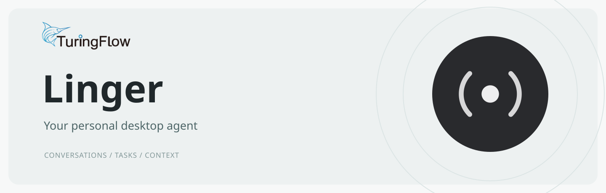
</a>

Linger is an open-source personal desktop agent that brings conversations, tasks, files, and a knowledge base into one workspace.

<a href="docs/development.md">Development guide</a> · <a href="https://gcomply.aotsea.com/linger">Website</a> · <a href="CONTRIBUTING.md">Contributing</a>

  
  
  

<a href="README.md">English</a> · <a href="README.zh-CN.md">简体中文</a>

## AI-native interaction

Give tasks by text or voice, and follow their progress and results in conversation. Customize the desktop with themes, animated effects, and wallpapers.

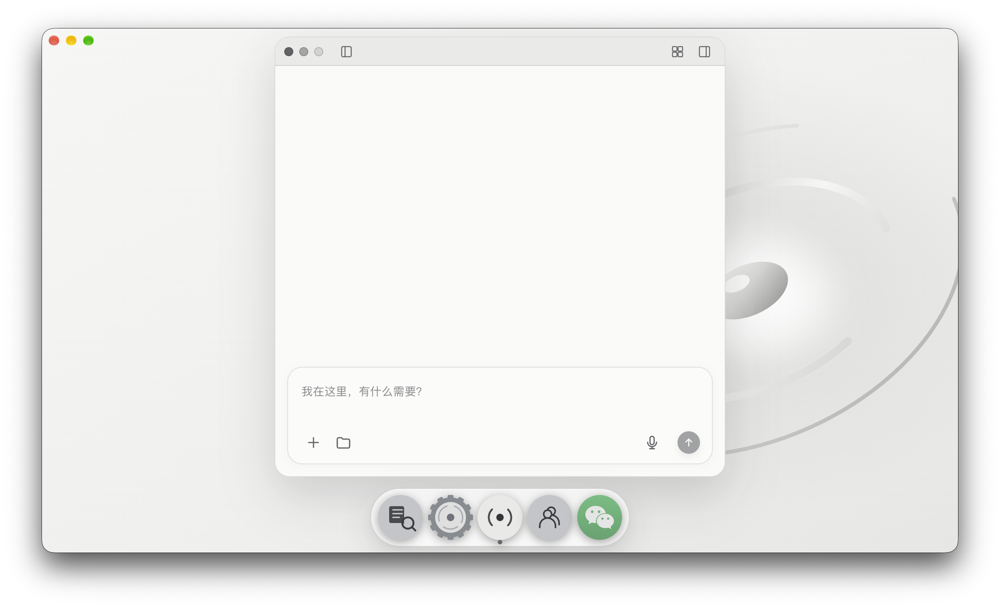

## Themes

Choose from light and dark appearances and six desktop themes, including animated scenes.

  <a href="docs/images/theme-light.jpg">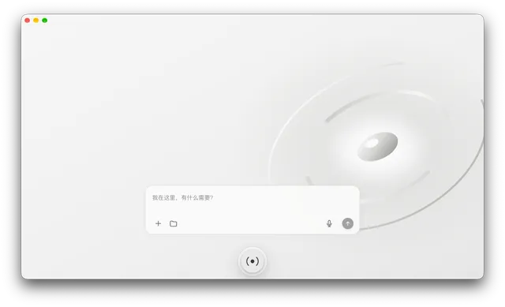</a><a href="docs/images/theme-dark.jpg">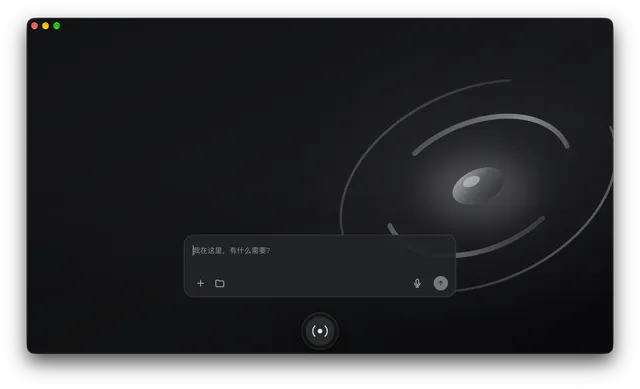</a><a href="docs/images/theme-graphite-night.jpg">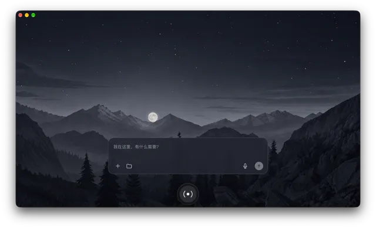</a><a href="docs/images/theme-ice-blue-dawn.jpg">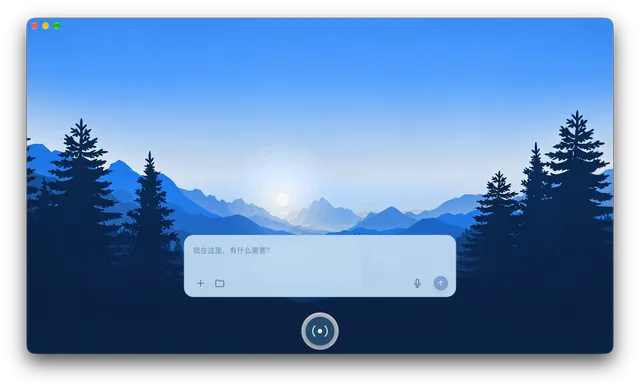</a>
   
  <a href="docs/images/theme-forest-green.jpg">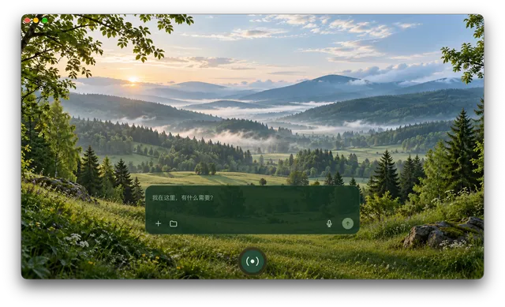</a><a href="docs/images/theme-dragon-realm.jpg">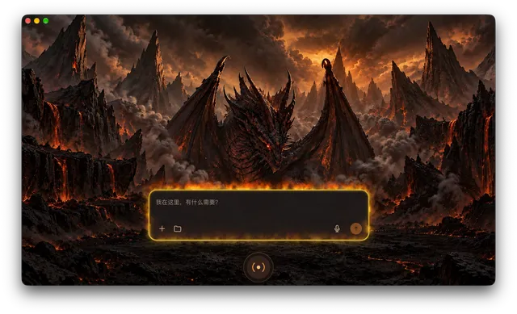</a><a href="docs/images/theme-quiet-sea.jpg">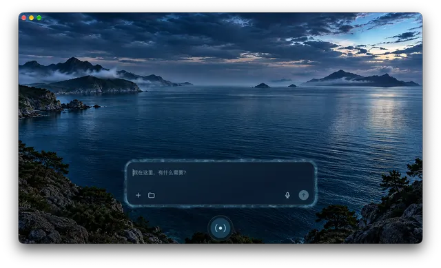</a>

## Multiple agent frameworks

Manage WorkBuddy, Codex, and DeepSeek Harness in compute settings, and choose a framework and model for each task.

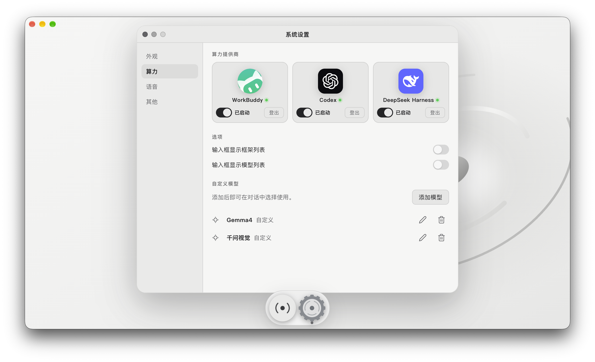

## Desktop

Organize work with task cards and conversation groups, browse files on the desktop, and drag them into conversations. Choose a model and runtime independently for each chat window.

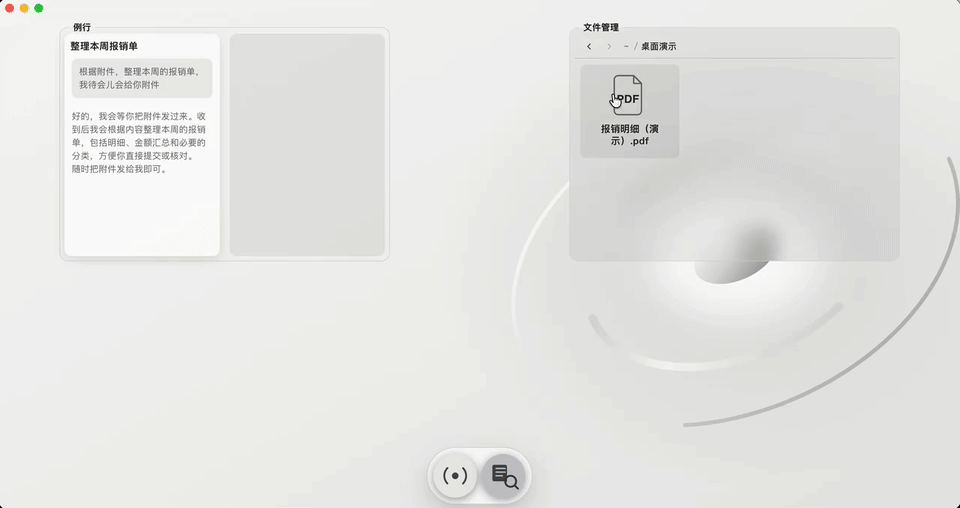

## Knowledge base

Index local content and search it in conversation using natural language.

  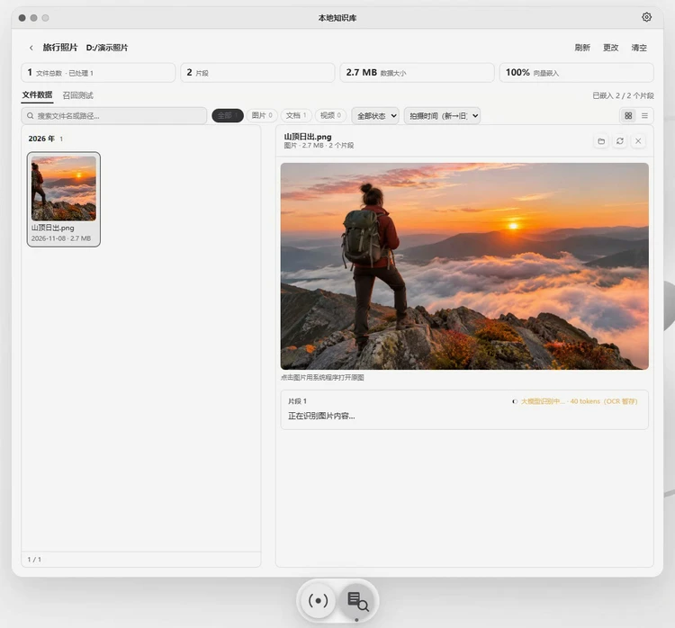 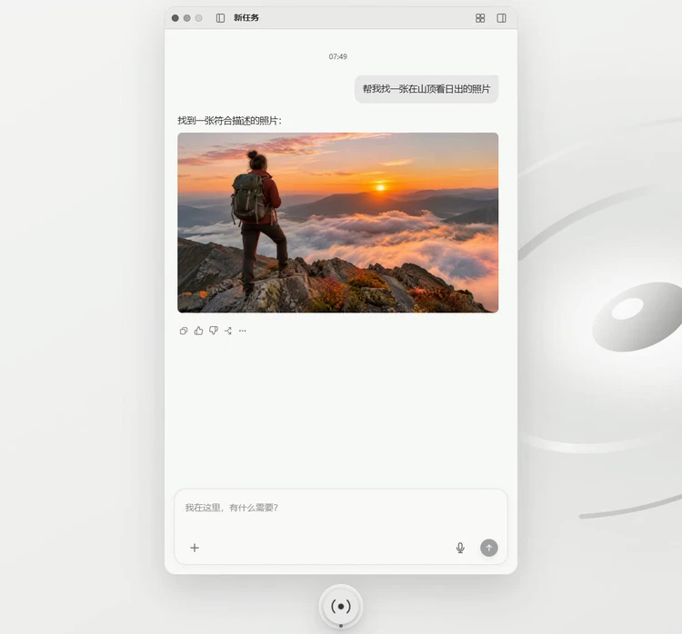

Manage and index　 ·　 Search in chat

## Collaboration

Collaborate with your team and Linger in group chats, create artifacts from shared context, and refine them with feedback.

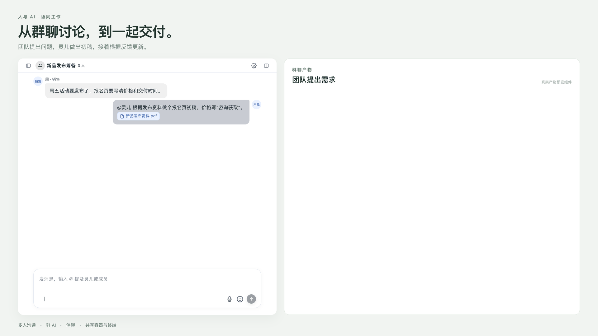

## Contributing

Issues and pull requests are welcome. See the [contributing guide](CONTRIBUTING.md), [code of conduct](CODE_OF_CONDUCT.md), and [security policy](SECURITY.md).

## License

[MIT](LICENSE)
