<a href="https://gcomply.aotsea.com/linger">
  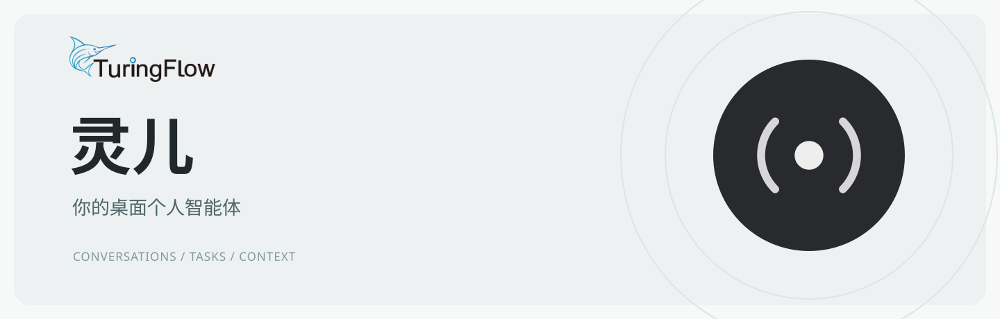
</a>

灵儿是一个开源桌面个人智能体，将对话、任务、文件和知识库放在同一个工作环境中。

<a href="docs/development.zh-CN.md">开发指南</a> · <a href="https://gcomply.aotsea.com/linger">项目网站</a> · <a href="CONTRIBUTING.md">参与贡献</a>

  
  
  

<a href="README.md">English</a> · <a href="README.zh-CN.md">简体中文</a>

## AI 原生的交互

通过文字或语音交代任务，在对话中查看进度和结果。桌面支持切换主题、动态效果和自定义壁纸。

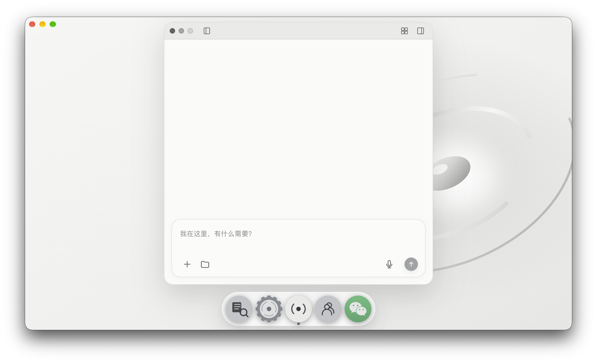

## 主题

支持浅色、深色外观和六套桌面主题，其中部分带有动态效果。

  <a href="docs/images/theme-light.jpg">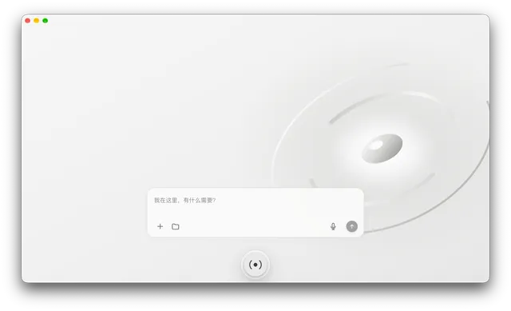</a><a href="docs/images/theme-dark.jpg">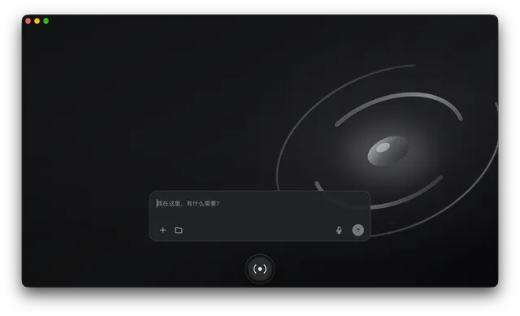</a><a href="docs/images/theme-graphite-night.jpg">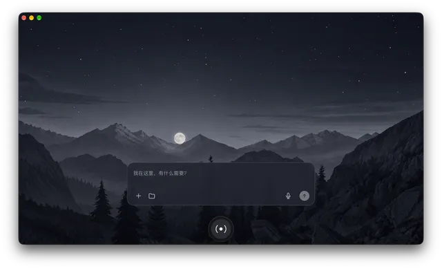</a><a href="docs/images/theme-ice-blue-dawn.jpg">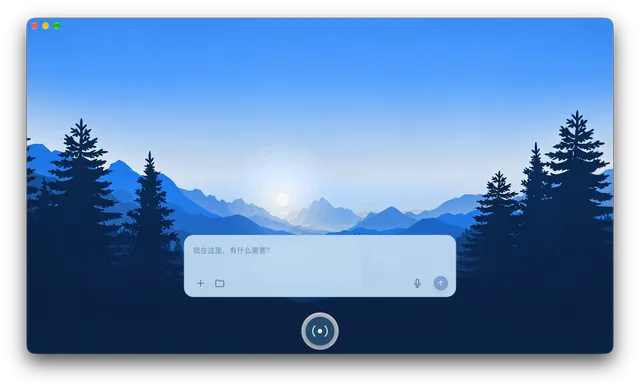</a>
   
  <a href="docs/images/theme-forest-green.jpg">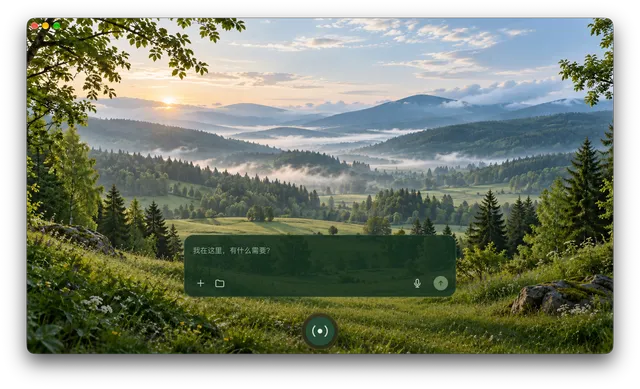</a><a href="docs/images/theme-dragon-realm.jpg">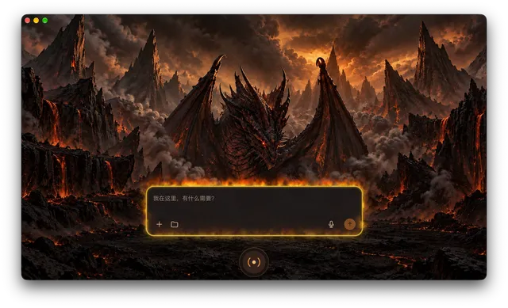</a><a href="docs/images/theme-quiet-sea.jpg">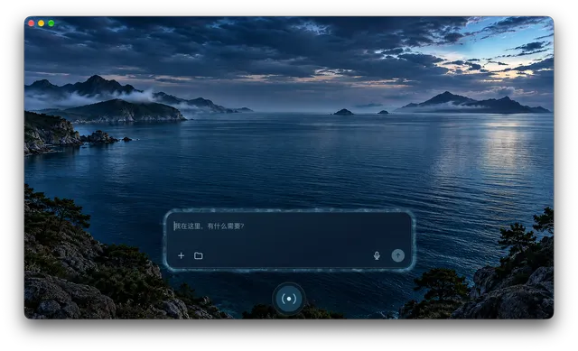</a>

## 支持多种 Agent 框架

在算力设置中管理 WorkBuddy、Codex 和 DeepSeek Harness，按任务选择框架和模型。

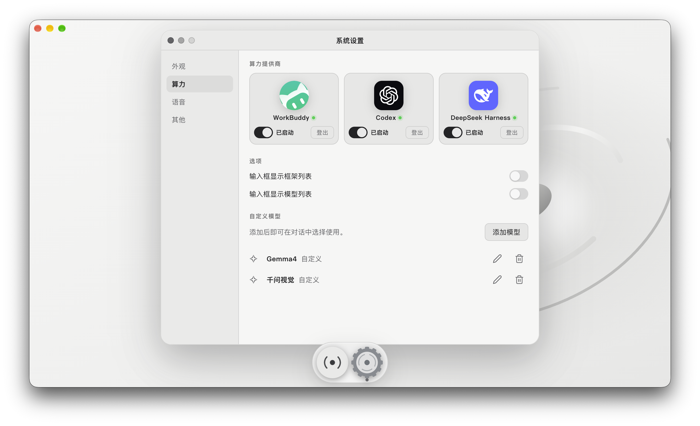

## 桌面

用任务卡片和会话组组织工作，直接在桌面浏览文件并拖入会话。多个聊天窗口可以分别选择模型和运行框架。

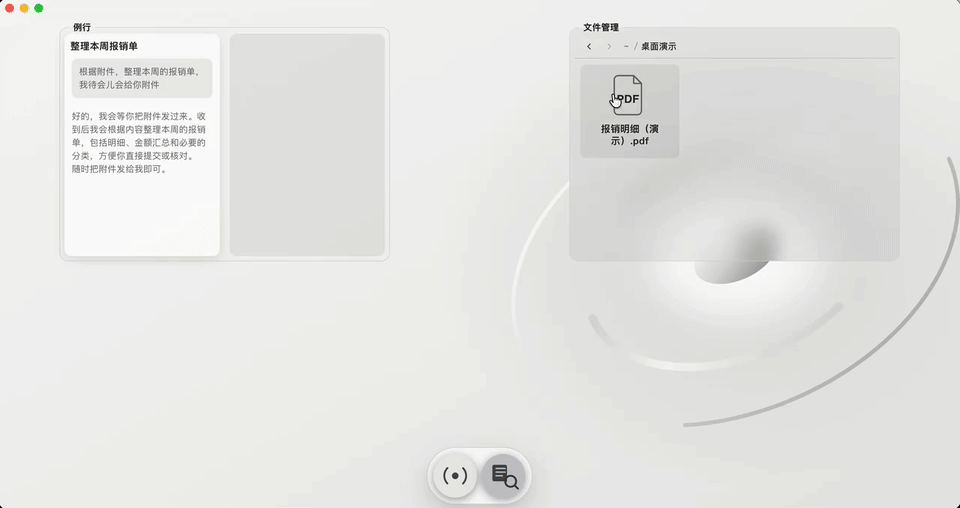

## 知识库

索引本地内容，在对话中用自然语言检索。

  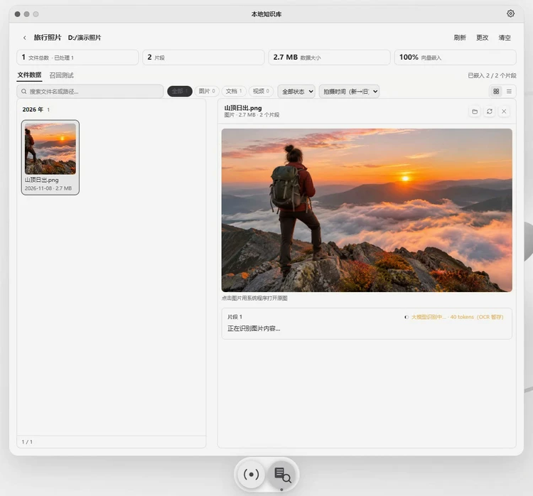 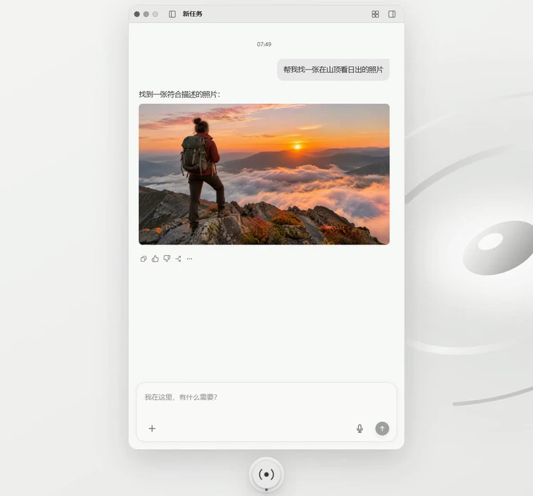

管理与索引　 ·　 在对话中查询

## 协同

在群聊中与他人和 AI 共享讨论上下文；也可以通过私密伴聊获取回复建议，自行决定是否发送。

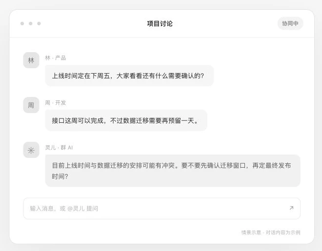

## 参与贡献

欢迎提交 issue 和 pull request。请参阅[贡献指南](CONTRIBUTING.md)、[行为准则](CODE_OF_CONDUCT.md)和[安全政策](SECURITY.md)。

## License

[MIT](LICENSE)
